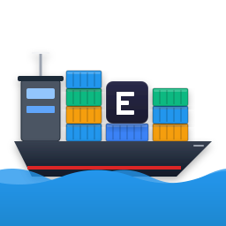
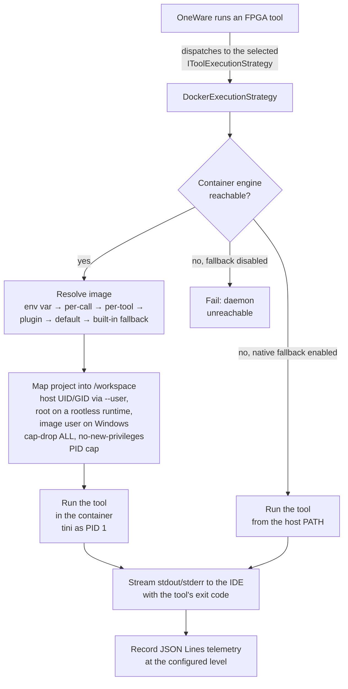

# OneWare Container Extension

[](https://github.com/FEntwumS/FEntwumS.ContainerExtension/actions/workflows/dotnet.yml)
[](License.md)


A [OneWare Studio](https://github.com/one-ware/OneWare) plugin that runs FPGA toolchains (GHDL, Yosys,
nextpnr, gmpack, Icarus, Verilator, SymbiYosys) inside containers without changing the user's workflow.
It plugs into OneWare's pluggable tool-execution strategy, maps the project into a container, runs the
tool there with its paths mapped into the container, and streams output back to the IDE, so a build
behaves identically across machines with no host toolchain install.

Developed as part of the Master's thesis *Design and Implementation of a Modular Architecture for the
Transparent Integration of Containerized Execution Environments for Heterogeneous Open-Source Binaries in
OneWare Studio* by Mert Torun at TH Köln (2026), openly available at
[https://doi.org/10.57683/EPUB-3597](https://doi.org/10.57683/EPUB-3597). The code has changed since the
thesis was submitted.



## Installation

- **From OneWare Studio:** open Extras > Extensions, search for "Container Extension", and install. On
  OneWare Studio before 1.0.43, restart it once, so that the Container Dashboard's tab and menu entry
  appear. If the search finds nothing, add the extension's manifest as a package source first; the
  [getting-started guide](docs/articles/getting-started.md) gives the link. The plugin ships as a managed
  `net10.0` assembly; OneWare provides the runtime.
- **Side-load a local build:** publish the plugin and copy it into the OneWare plugins directory
  (`~/OneWareStudio/Packages/Plugins/` on Linux/macOS). See [docs/articles/getting-started.md](docs/articles/getting-started.md).

OneWare Studio 1.0.45 or later is required; the plugin is built against OneWare.Essentials 1.0.45 and
implements the tool-execution strategy interface that OneWare introduced in 1.0.40. A running container
engine (Docker, Podman, OrbStack, or Colima) is required for containerized execution. Containerized runs use the toolchain image
`fentwums/oss-cad-suite:latest`, which is on no registry: build it once with Build Local Image in the
Container Dashboard, or with [`docker/build_oss_cad_suite.sh`](docker/build_oss_cad_suite.sh).

## Repository layout

Each top-level directory carries its own README with the detail; this is the map.

| Path | Contents |
|---|---|
| [`src/`](src/README.md) | The plugin assemblies. `ContainerExtension` is the core: `IToolExecutionStrategy`/`DockerExecutionStrategy`, the registry client, settings, telemetry, and the Avalonia Docker dashboard (`net10.0`, `IsAotCompatible`, source-generated JSON and regex). |
| [`tests/`](tests/README.md) | `ContainerExtension.UnitTests` (xUnit: validators, command building, path mapping, telemetry, registry parsing, SSRF guards, plus gated container E2E). |
| [`docker/`](docker/README.md) | Build inputs for the hardened `fentwums/oss-cad-suite` toolchain image: the digest-pinned `Dockerfile`, `build_oss_cad_suite.sh`, and `pull_all_images.sh`. |
| [`docs/`](docs/articles) | DocFX site sources — prose guides under `articles/` and the generated API reference. See [Documentation](#documentation) to build and view the HTML. |

The runtime design (the execution-strategy integration, the container lifecycle, the hybrid fallback) is summarized under
[Execution model](#execution-model) and detailed in [docs/articles/architecture.md](docs/articles/architecture.md).

## Execution model

The plugin coordinates execution through a hybrid strategy:



- **Containerized (opt-in per tool):** each tool's *Execution Strategy* setting defaults to native; selecting
  the Docker strategy routes that tool through a container, which pulls and runs the toolchain image, pinning
  the container process to the host UID/GID via `--user` so output files are not root-owned. On a rootless
  runtime the container runs as root (`--user 0:0`), which the runtime's user namespace maps to the host
  user who started it, so output files belong to that user. On Windows hosts `--user` is left out and the
  image's default user applies, `oneware` in the toolchain image. `tini` runs as PID 1 to reap children and
  forward signals.
- **Native fallback:** if the daemon is unreachable and `Allow Native Fallback` is enabled, the tool is
  located on the host `PATH` and run natively so work is not blocked.
- **Telemetry:** execution records are written as JSON Lines with a configurable level (`Off`,
  `Errors Only`, `Info`, `Verbose`) and retention. See [docs/articles/telemetry.md](docs/articles/telemetry.md).

## Security

- Containers run as the host UID/GID via `--user`. On a rootless runtime they run as root (`--user 0:0`),
  which the runtime's user namespace maps to the host user who started it, so output files belong to that
  user; this root holds no capabilities. On Windows hosts the image's default user applies (`oneware` in
  the toolchain image). `tini` runs as PID 1. Every container
  drops all capabilities (`--cap-drop=ALL`), forbids privilege escalation
  (`--security-opt no-new-privileges`), and caps the task count as a fork-bomb backstop.
- A run inside a project mounts the project folder, the folder that holds the `.fpgaproj` file,
  read-only at `/workspace`, and the tool starts in its working directory below `/workspace`. A tool
  writes only where release 1.2.1 let it write, in its working directory: for a tool that writes, the
  working directory is bound a second time, writable, at its place below `/workspace`, such as
  `/workspace/build/netlist`; every other tool gets the read-only project alone. When the working
  directory is the project folder, or no project file lies in it or a folder above it, the working
  directory alone is mounted at `/workspace`, read-only or writable by tool, as in release 1.2.1. A
  project folder that is a file system root, such as a drive root on Windows, or is or contains the
  home folder, a shared temporary folder or a folder the mount deny list below blocks, is never
  mounted; the working directory is mounted alone instead. As in release 1.2.1, a tool that writes
  may change anything in its working directory, a
  `.git` there included, with one exception: when the top-level `.git` of the writable working
  directory is a folder or the `.git` file of a git worktree or submodule, it is bound a second time,
  read-only, at the same place in the container, such as `/workspace/.git` or
  `/workspace/build/netlist/.git`. A `.git` that is a symbolic link is not bound. On a host with a
  case-insensitive file system, other spellings such as `/workspace/.GIT` reach the same read-only
  folder; this was measured with OrbStack on macOS only. Only that one path is bound: the metadata
  folder that a `.git` file names and a repository nested deeper in the working directory stay
  writable for a tool that writes when they lie inside the working directory. After the bind check,
  and once more after the image is made available, right before the container is created, a run fails
  with an error saying that the project changed while the run was prepared when a bind no longer names
  exactly the folder it was made for: the project folder at `/workspace`, the working directory at
  its own place, or its `.git`, for example because a folder or a `.git` was replaced with a symbolic
  link. A short window between that last check and the mount by the engine remains. When the working
  directory lies below the project folder, `/workspace` names the project folder, not the working
  directory as in release 1.2.1, so a script that wrote to `/workspace` for its working directory
  must use a relative path or the working directory's place in the container instead. The folders of
  output paths that a tool's arguments name are created only in the working directory. A path
  argument the extension recognises as a path (a path on its own, the value after `=` of an option
  such as `--input=<path>` or `-DFOO=<path>`, a path attached to `-P`, a path attached to `-o` that
  is rooted or starts with `~/` or `~\`, or a path in an argument that a space, a comma or a
  semicolon splits, such as the script after `-p`) fails the run when it lies outside the mounted
  folder, also through a symbolic link that leads out, before the image is pulled, with an error
  that names the path and the folder. A path on its own or the value after `=` counts only when it
  holds a `/` or `\`, is rooted, starts with `~/` or `~\` or is the value after `--workdir=`; any
  other value, such as `x.json` or a bare `..`, also as the value after `-o` or in `--input=..`, is
  passed on unchanged and unchecked. Such a name lies in the working directory, except `..`, which
  names the folder above it and lies outside the mounted folder whenever the working directory is
  mounted alone: without a project file, in a working directory at the project root, or below a
  project folder that is never mounted because it is a file system root, such as a drive root on
  Windows, or is or contains the home folder, a shared temporary folder or a folder the mount deny
  list blocks.
  Only `/dev/null`, `/dev/zero`, `/dev/urandom` and paths under the image's `/bin`, `/usr/bin`,
  `/lib` and `/lib64` pass through unchanged, as paths in the container. The extension does not
  expand a `~`: it checks `~/x` and `~\x` as a folder `~` in the working directory and passes
  the argument on as written, except that every `\` becomes `/`, as in any argument. A tool may
  expand a `~/` itself, as yosys does with its `HOME`, which the container sets to `/tmp` unless
  the run's environment sets one; the path then names a place in the container that the check
  never saw, and what the tool writes there is lost with the container. A relative path or an
  absolute host path is the reliable form. A path attached directly to an option, without `=` and
  other than these forms after `-P` and `-o`, such as `-obuild/out.json`, `-I/abs/include` or
  `+incdir+/abs/include`, is not recognised as a path and is not mapped. When it holds a `/` or `\`,
  the whole argument is checked as a path in the working directory, its option letters read as the
  first folder: it reaches the tool unchanged, apart from every `\` becoming `/`, while that path
  stays inside the mounted folder, and fails the run when it leaves it. A `..` right after the
  option letters therefore only leaves the folder they form, such as `-o..`, so the check climbs up
  to two levels fewer than the tool does,
  and where that path leads through a symbolic link, the argument comes back as the container path it
  resolves to, without its option letters. A path given as a separate argument, such as
  `-o build/out.json`, or after `=` is checked as the tool reads it when it counts as a path. A value
  that holds `://`, such as a URL, is not checked, also after `--workdir=` or attached to an option,
  unless it is rooted or starts with `~/` or `~\` and stands on its own, after `=` or attached to
  `-P` or `-o`; in an argument that a space, a comma or a semicolon splits, it is never checked. Two
  GHDL forms are rewritten instead of checked: the value of `--work` or `-work`, after `=` or as the
  next argument, becomes a library name, and with `ghdl` and one of `-m`, `-e`, `-r`, `--synth`,
  `--elab` or `--run`, an argument that ends in `.vhd` or `.vhdl` becomes its unit name. The
  behaviour is pinned by an adversarial path-containment test corpus that runs in CI.
- A mount deny list rejects binds of critical host paths (`/etc`, `/proc`, `/sys`, `/run`, the Docker
  socket, …); on Linux a project on a removable drive under `/run/media/`, where udisks2 mounts it, may
  be bound.
- The registry client uses HTTPS, and plain HTTP only for a registry named as `localhost` or a loopback
  address; it scopes forwarded credentials to the matching host and rejects any other host name that
  resolves to a loopback or internal address (SSRF defense).
- Supply chain: `NuGetAudit`, an SBOM and OIDC build attestations on releases, and CodeQL plus Trivy
  scans in CI. The runtime image pins its base by digest and verifies the toolchain tarball against a
  committed SHA-256 (fail-closed); image integrity is anchored on these committed digests and the
  per-run recorded image digest. Provenance is TLS-trusted, not yet cosign-signed.

## Supported container runtimes

| Runtime | Endpoint | Notes |
|---|---|---|
| Docker | `/var/run/docker.sock`, `~/.docker/run/docker.sock`; on Linux also `~/.docker/desktop/docker.sock` (Docker Desktop) and `/run/user/{uid}/docker.sock` (rootless) | Probed first |
| Podman | `/run/user/{uid}/podman/podman.sock`, podman-machine | Rootless |
| OrbStack / Colima | per-runtime sockets | Probed via a priority list |
| Custom | `Custom Daemon Socket` setting | Overrides probing |

On Windows the daemon is reached over the named pipe; the connection path is validated before use.

## Building and testing

```bash
git clone --recurse-submodules https://github.com/FEntwumS/FEntwumS.ContainerExtension.git
cd FEntwumS.ContainerExtension

dotnet format OneWare.ContainerExtension.slnx --verify-no-changes
dotnet build  OneWare.ContainerExtension.slnx -warnaserror -c Release
dotnet test   OneWare.ContainerExtension.slnx -c Release
```

The container E2E tests are skipped in CI (Docker Hub rate limits and image-pull flakiness). What they
need to run locally is listed under [Running the container tests](CONTRIBUTING.md#running-the-container-tests).

## Documentation

Prose guides live under [docs/articles](docs/articles): getting started, configuration, architecture,
telemetry, and limitations. The full site bundles those guides with an API reference
generated from the source by [DocFX](https://dotnet.github.io/docfx/):

```bash
dotnet tool install -g docfx     # once
docfx docs/docfx.json --serve    # build and serve at http://localhost:8080
```

`docfx docs/docfx.json` (omitting `--serve`) regenerates the API metadata and produces the static HTML under
`docs/_site/`. The bare `docfx build` subcommand skips metadata generation, so run the full command above for
a complete site with the API reference.

## Citation

If you use this software, cite it via [CITATION.cff](CITATION.cff).

## License

[MIT](License.md) © 2025–2026 Mert Torun
