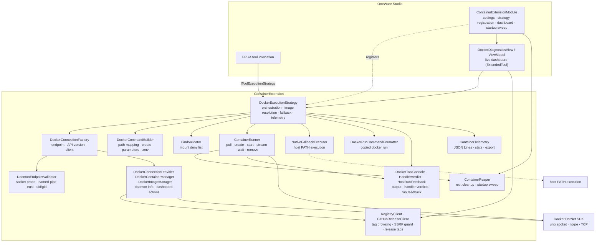

# Architecture Overview

The OneWare Container Extension implements the **Hybrid Strategy Pattern** for transparent containerized execution of FPGA toolchains within OneWare Studio. `DockerExecutionStrategy` is the coordinator: it prepares each run and hands every concern to a collaborator of its own, most of them under `Services/Docker/`.

## Component Diagram



## Source Files

| File | Purpose |
| ------ | --------- |
| `ContainerExtensionModule` | Registers the engine settings (plus per-tool image overrides), registers the Docker strategy, the dockable DataTemplate and the dashboard command, checks at startup, with retries, that the daemon is reachable, then sweeps leftover containers |
| `DockerExecutionStrategy` | The `IToolExecutionStrategy`: checks the daemon endpoint, resolves the image, has the parameters built and checked, runs the container or the native fallback, records telemetry, and serves the dashboard's daemon actions |
| `Services/Docker/DockerConnectionFactory` | Resolves the daemon endpoint (custom socket, `DOCKER_HOST`, OS defaults), verifies it, negotiates the API version and builds the client with its connection, image and container managers |
| `Services/Docker/DaemonEndpointValidator` | Probes the Unix sockets and checks their ownership, classifies the process behind a Windows named pipe, and resolves the uid/gid for `--user` |
| `Services/Docker/DockerConnectionProvider` | Daemon connection health, runtime detection and system-info caching |
| `Services/Docker/DockerContainerManager` | Container list, logs, metrics, stop, start, restart and remove for the dashboard |
| `Services/Docker/DockerImageManager` | Image list, pull of all images, prune, disk usage and removal for the dashboard |
| `Services/Docker/DockerCommandBuilder` | Host-to-container path mapping, the container's create parameters (hardening, limits, ports, labels, environment) and `.env` parsing |
| `Services/Docker/BindValidator` | Canonicalizes each bind mount and rejects critical host and container paths |
| `Services/Docker/ContainerRunner` | The run itself: pull per the pull policy, create, attach or follow the logs, start, demultiplex the output, sample resources, wait, and stop and remove |
| `Services/Docker/ContainerReaper` | Tracks the containers of the session, removes them on exit, Ctrl-C or disposal, and sweeps leftovers of the extension at startup |
| `Services/Docker/DockerToolConsole` | Level-gated tool-console output with optional timestamps, and line draining for the output streams |
| `Services/Docker/HandlerVerdict` | Records whether an output or error handler rejected a line, which fails the run |
| `Services/Docker/HostRunFeedback` | OneWare's own channels for a run: the output window, the error log and the status bar entry |
| `Services/Docker/NativeFallbackExecutor` | Finds the tool on the host `PATH` and runs it there when the daemon is unreachable and native fallback is allowed |
| `Services/Docker/DockerRunCommandFormatter` | The copied `docker run` command, quoted for the host's shell, and the template built from the settings |
| `ContainerTelemetry` | JSON Lines logger with redaction, stats and export |
| `PathCanonicalizer` | Symlink-resolved canonical paths for the mount and telemetry-directory checks |
| `SettingsExtensions` | `SafeGetSetting`, a settings read that falls back instead of throwing |
| `Registry/RegistryClient` | Registry tag and manifest queries with SSRF-guarded realm resolution |
| `Services/GitHubReleaseClient` | GitHub release lookups for the toolchain image |
| `Services/CappedHttpResponse` | Size-capped reading of the registry and GitHub answers |
| `Validations/*` | The setting validators: container name prefix, daemon socket, image reference, memory and CPU limits |
| `Views/DockerDiagnosticsView` | Docker Desktop-style live dashboard, split by section into partial classes; `ActiveConfigLayout`, `DashboardFingerprint` and `UIBuilderHelpers` support it |
| `ViewModels/DockerDiagnosticsViewModel` | `ExtendedTool` docking adapter for the dashboard |

## Image Resolution Hierarchy

```text
1. ONEWARE_DOCKER_IMAGE env var        (highest - CI/CD override)
2. docker.image of the call            (ToolCommand.StrategyConfigurationOverrides)
3. ContainerImage_{tool} per-tool      (settings UI)
4. docker.image of the tool            (IToolService.GetStrategyConfiguration)
5. ContainerExtension_DefaultImage     (global setting; defaults to fentwums/oss-cad-suite:latest)
6. hdlc/ghdl:yosys                     (hardcoded fallback when no default image is set)
```

Values from steps 2 and 4 are checked against the image grammar before use; see [Configuration](configuration.md#image-resolution-hierarchy).

## Container Lifecycle

```text
DockerExecutionStrategy.ExecuteAsync:
    command line to the output window, status bar entry
    -> check the daemon endpoint -> (unreachable: native fallback, or fail)
    -> ResolveImage -> BuildContainerParameters -> BindValidator.ValidateBinds
    -> EnsureImage (pull per the pull policy) -> DockerRunCommandFormatter.Reconstruct
ContainerRunner.RunContainerAsync:
    -> CreateContainer (tracked by ContainerReaper)
    -> AttachContainer -> StartContainer      (named pipe: StartContainer, then follow the logs)
    -> DrainLines (demultiplex stdout/stderr), resource stats sampled alongside
    -> WaitContainer -> InspectContainer (OOM) -> stop and remove as needed
DockerExecutionStrategy.ExecuteAsync:
    -> Log Telemetry -> exit code or cancellation to OneWare Studio
```

## Feedback in OneWare Studio

A foreground run (`ExecuteAsync`) reports to OneWare Studio the way the native strategy does, whatever handlers the caller passes:

- before the run, the command line in the output window, as `[folder]: tool arguments`
- during the run, a status bar entry with the command's status message, the elapsed time when the caller asks for a timer, and cancel
- after the run, `exited with code N` in red or `cancelled!` in orange

Output and error lines go to the caller's `OutputHandler` and `ErrorHandler`. A handler the caller leaves unset falls back to the output window or the error log, and an error line then fails the run, even when the tool exits with code 0. A handler that returns `false` fails the run as well. Background runs (`StartProcess`, `StartWeakProcess`) report nothing on their own, like the native strategy's background processes.

## Docking System Integration

The dashboard integrates with OneWare Studio's dock infrastructure via the `ExtendedTool` base class:

1. **`DockerDiagnosticsViewModel`** extends `ExtendedTool` with `CanFloat = true` and `CanPin = true`
2. **`FuncDataTemplate`** inserted at index 0 in `Application.DataTemplates` to bypass OneWare's `ViewLocator` (which requires parameterless constructors)
3. **`IMainDockService.RegisterLayoutExtension<DockerDiagnosticsViewModel>(DockShowLocation.RightPinned)`** registers the default layout slot
4. An **`IApplicationCommandService`** command and a **`View > Tool Windows > Container Dashboard`** menu item (registered via `IWindowService`) both open the singleton ViewModel via `IMainDockService.Show(vm, DockShowLocation.RightPinned)`, preventing duplicate tabs
